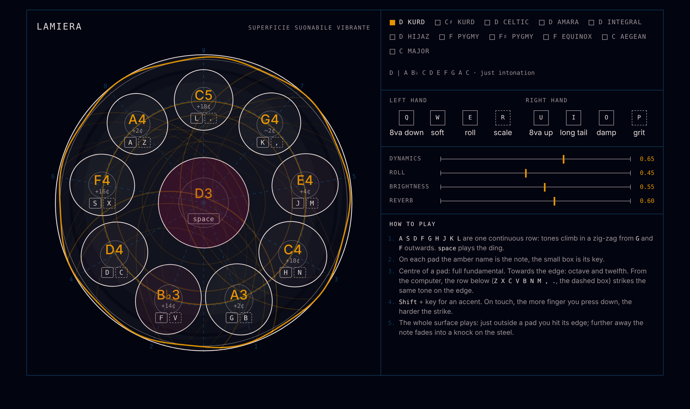

# lamiera

*superficie suonabile vibrante*

A handpan you play in the browser, with the computer keyboard or by touch. One HTML file, no dependencies, no install.

## Play

Open `index.html` in a browser, or the GitHub Pages version of this repo. Press any key or tap the pan to wake up the audio.

### Keyboard

The home row is one continuous line of tones. They climb in a zig-zag from the middle of the keyboard outwards, the way the tone fields climb around a real handpan.

| key | A | S | D | F | **G** | H | J | K | L |
|---|---|---|---|---|---|---|---|---|---|
| tone | 8 | 6 | 4 | 2 | **1** | 3 | 5 | 7 | 9 |
| edge | Z | X | C | V | B | N | M | , | . |

- **space** plays the ding, the low note in the centre.
- The **home row** strikes the centre of a tone field: full fundamental.
- The **row below** strikes the same tone on its edge: more octave, twelfth and steel.
- **Shift** + key plays an accent.

On each pad the amber name is the note; the solid box is its centre key and the dashed box its edge key.

### Touch

The whole surface plays. Where you strike changes the sound:

- the centre of a pad gives the fundamental, the edge gives the harmonics;
- just outside a pad you hit its edge; further away the note fades into a knock on the steel;
- the more finger you press down, the harder the strike (where the browser reports contact size or pressure).

### Modifiers

Laid out like the top row of the keyboard, one group per hand.

| left hand | | right hand | |
|---|---|---|---|
| **Q** | octave down (hold) | **U** | octave up (hold) |
| **W** | soft (hold) | **I** | long tail (hold) |
| **E** | roll (hold): repeated strikes on the held tones, or on the ding | **O** | damp all ringing notes |
| **R** | next scale | **P** | grit, a stepped lo-fi distortion (toggle) |

### Controls

- **dynamics**: base strike strength for keyboard and mouse
- **roll**: density of the roll
- **brightness**: how much twelfth and metal comes out
- **reverb**: amount of the long (12 s) reverb

## Scales

Each scale is tuned in just intonation on its own ding.

| scale | ding | tones |
|---|---|---|
| D Kurd | D | A B♭ C D E F G A C |
| C♯ Kurd | C♯ | G♯ A B C♯ D♯ E F♯ G♯ B |
| D Celtic | D | A C D E F G A C D |
| D Amara | D | A C D E F A C D E |
| D Integral | D | A B♭ C D E F A C D |
| D Hijaz | D | A B♭ C♯ D E F G A C |
| F Pygmy | F | G A♭ C E♭ F G A♭ C E♭ |
| F♯ Pygmy | F♯ | G♯ A C♯ E F♯ G♯ A C♯ E |
| F Equinox | F | A♭ C D♭ E♭ F G A♭ C E♭ |
| C Aegean | C | E G B C E F♯ G B C |
| C Major | C | G A B C D E F G A |

## Sound

Every strike is synthesised, not sampled:

- each tone rings with its fundamental, octave and twelfth, tuned like the fields of a real handpan, plus a few short inharmonic steel modes;
- the octave blooms a few milliseconds after the fundamental;
- the fingertip is a soft burst of noise tuned to the note, never the same twice;
- the ding answers quietly to every strike, like the dome of the shell;
- a long convolution reverb darkens as it fades.

On screen, every strike sends rings across the steel for as long as the note lasts, and the rim of the pan trembles in amber with the actual output level.

## Origin

Lamiera started as a patch for the Shbobo Shnth, a handpan whose keyboard borrowed the binary touch pads of Lorre-Mill's Keyed Mosstone, and grew into this browser instrument.
